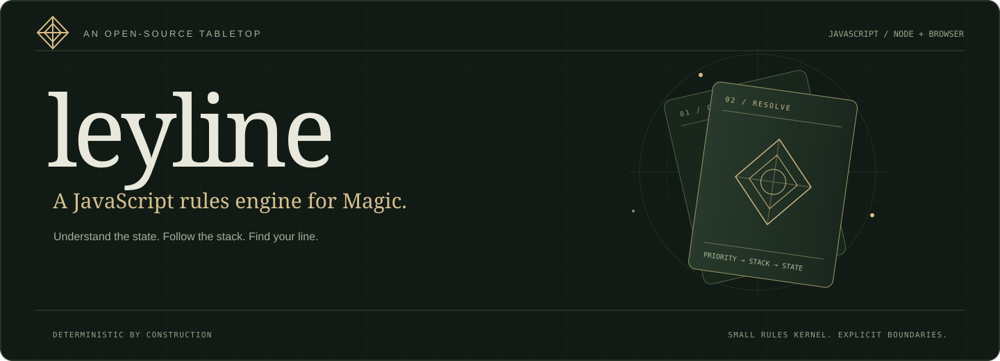
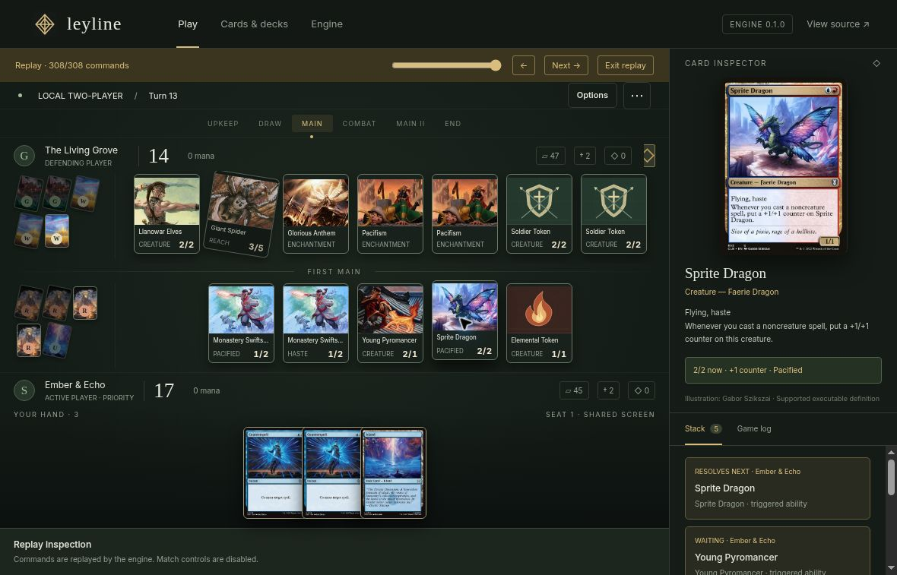
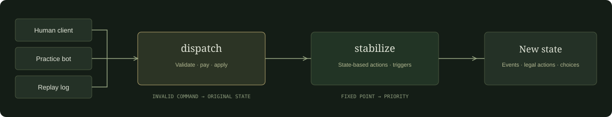

<p align="center">
  
</p>

<p align="center">
  <a href="#start-playing">Start playing</a> ·
  <a href="docs/ARCHITECTURE.md">Architecture</a> ·
  <a href="docs/SUPPORT.md">Rules & card support</a> ·
  <a href="docs/CONTRIBUTING.md">Contributing</a>
</p>

<p align="center">
  <a href="https://github.com/StormBurpee/leyline-mtg/actions/workflows/ci.yml"></a>
  
  <a href="LICENSE"></a>
</p>

Leyline is a local-first Magic rules engine with a playable tabletop, written in JavaScript. The same kernel powers the browser client, the practice opponent and deterministic replays. No Java backend. No rules hidden in click handlers.

**Development preview:** 50 executable cards and three token definitions. A scoped rules kernel, not a complete Forge port or a tournament-ready client. [The boundaries are documented.](docs/SUPPORT.md)

<p align="center">
  
  <sub>Actual client capture. A saved match, replayed through the engine. Card art belongs to its respective owners.</sub>
</p>

## Start playing

```sh
git clone https://github.com/StormBurpee/leyline-mtg.git
cd leyline-mtg
npm start
```

Open the local address printed in your terminal. Requires **Node.js 22+**. There are no runtime dependencies to install.

Choose **Ember & Echo** for spells and cast triggers, or **The Living Grove** for creatures, tokens and combat tricks. Play against the practice bot or share a screen in local two-player mode. Hover a card to inspect it. Click to play, target or activate. The stack and game log stay visible.

For development:

```sh
npm ci
npm run check
npm run typecheck
npm run format:check
npm run build
```

`dist/` is a portable static client. The JavaScript engine also runs independently in Node.

## One engine. Every decision.



| At the table                     | In the engine                                                    |
| :------------------------------- | :--------------------------------------------------------------- |
| Cast, respond, hold priority     | Explicit priority and LIFO stack resolution                      |
| Choose targets and damage splits | Legal-action validation; targets checked again on resolution     |
| Order your triggers              | Pending triggers, state-based stabilization and APNAP ordering   |
| Save, resume, inspect            | Seeded shuffles, versioned command logs and deterministic replay |
| Add a supported card             | Declarative costs, effects, triggers and regression tests        |

Rejected commands leave the input state unchanged. Zone incarnations prevent stale targets from attaching to a creature that left and returned. Historical records are immutable; source state is separate from presentation.

```js
import { createGame, dispatch, exportReplay, replay } from './packages/engine/src/index.js';

let state = createGame({ seed: 731 });

const result = dispatch(state, {
  type: 'keep',
  player: 0,
  expectedRevision: state.revision,
});

if (result.ok) state = result.state;

const restored = replay(exportReplay(state));
```

Public TypeScript declarations are included. The implementation stays JavaScript.

## Small enough to understand

```text
packages/engine/src/   State, commands, costs, stack, effects, combat, bot
packages/engine/test/  Rule examples, rejection cases and replay regressions
apps/web/             Tabletop, card inspector, deck import and replay viewer
scripts/              Local server, static build and maintenance utilities
docs/                 Architecture, support manifest and contribution guide
```

The supported pool includes counterspells, prowess, cast triggers, token creation, +1/+1 counters, activated abilities, temporary effects, first/double strike, trample, deathtouch and lifelink. That is not a claim to implement every interaction those mechanics can have in the full game.

Commander, multiplayer, general layers/dependencies, replacement-effect ordering and unrestricted card support are still ahead. Unsupported imports fail visibly instead of becoming approximations. The bot is a deterministic sparring partner, not a competitive deck-testing oracle.

**Start with a rule, not a card count.** [Read the contribution guide →](docs/CONTRIBUTING.md)

## Standing on good work

[Forge](https://github.com/Card-Forge/forge) is the architectural reference and the inspiration for the project's ambition. Leyline is a separate JavaScript implementation, not an official Forge release. [Source and asset provenance →](docs/PROVENANCE.md)

Source code is **GPL-3.0-or-later**. Magic: The Gathering, card names, Oracle text and illustrations remain the property of their respective owners. Images are served by Scryfall; artist credits appear in the client. Inter and Newsreader are distributed under the SIL Open Font License.

This is an unofficial fan project, not affiliated with or endorsed by Wizards of the Coast. Replays contain both players' hidden cards; read the [security boundaries](SECURITY.md) before sharing them or building multiplayer.
